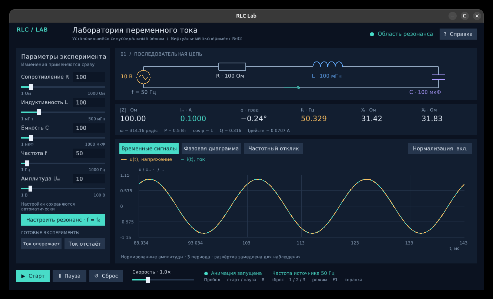

# RLC / LAB — лаборатория переменного тока

Образовательный симулятор последовательной RLC-цепи по **техническому заданию №32** из `RLC_Lab_Unity_Technical_Specification.pdf`.

**Основной проект — Unity 6 / C# / uGUI / TextMeshPro.** Дополнительно есть самостоятельная браузерная версия, которую можно запустить прямо сейчас без Unity. Это не Unity WebGL-сборка: это отдельный интерфейс с той же математической моделью.

> **Обновлено 23 ноября 2026:** проект импортирован и скомпилирован в Unity **6000.0.62f1**. Пройдены **15 EditMode- и 2 PlayMode-теста**. **Windows x64-сборка создана:** `Builds/Windows/RLC Lab.exe`, готовый архив — `Delivery/RLC_Lab_Windows_x64.zip`. Настоящий `.exe` запущен и визуально проверен под Wine. Запуск на отдельном Windows-ПК и профилирование на целевом оборудовании ещё не выполнялись.



## Готовая Windows-версия

Распакуйте **[Delivery/RLC_Lab_Windows_x64.zip](Delivery/RLC_Lab_Windows_x64.zip) целиком** и запустите `RLC Lab.exe`.
Unity, Python и .NET устанавливать для этой версии не нужно. Нельзя выносить `.exe` отдельно от `RLC Lab_Data`, `UnityPlayer.dll` и остальных файлов архива.

## Запустить без Unity

Нужны Python 3 и современный браузер. Из корня проекта:

```bash
python3 tools/serve.py --open
```

Или запустите `Start-Lab.sh` на Linux / `Start-Lab.bat` на Windows. В Windows также можно использовать:

```powershell
py -3 tools/serve.py --open
```

Адрес: **http://127.0.0.1:8080/Web/**. Остановка сервера: `Ctrl+C`. Если порт занят, добавьте `--port 8081`. После первого получения исходников интернет для браузерной версии не требуется. Открытие `index.html` через `file://` не поддерживается из-за модулей JavaScript; используйте локальный сервер.

## Открыть Unity-проект

1. Установите **Unity 6 LTS 6000.0.62f1** через Unity Hub, с модулем **Windows Build Support (Mono)**.
2. В Hub выберите **Add → Add project from disk** и корневую папку этого проекта — ту, где находятся `Assets`, `Packages`, `ProjectSettings`.
3. Дождитесь импорта пакетов. uGUI 2.0.0 включает TextMeshPro; необходимые TMP-ресурсы и кириллический шрифт уже находятся в `Assets`.
4. Выберите **RLC Lab → Открыть лабораторию** либо откройте `Assets/Scenes/Laboratory.unity`.
5. Нажмите **Play**.

Сцена содержит компонент `UIController`; интерфейс и сетки графиков создаются программно при запуске. Вручную связывать поля инспектора, создавать Canvas или импортировать TMP Examples не требуется. `ProjectSetup` автоматически задаёт разрешение 1920×1080, масштабирование, Legacy Input, Mono, .NET Standard и сцену для сборки.

Первый импорт Unity-пакетов требует подключения к Unity Package Registry. Для сборки нужна активированная подходящая лицензия Unity.

На текущем Linux-компьютере запуск Unity и Windows Build Support уже исправлены. Описание локального исправления `libxml2` без замены системных библиотек: [настройка Unity под Linux](Docs/UNITY_LINUX_SETUP.md).

## Что реализовано

- Визуальная последовательная схема: AC-источник, R, L, C, актуальные значения и направление мгновенного тока.
- Ползунки и числовой ввод для R **1–1000 Ом**, L **1–500 мГн**, C **1–1000 мкФ**, f **1–1000 Гц**, Uₘ **1–100 В**.
- Валидация формата, диапазонов, NaN и бесконечностей; точка и запятая поддерживаются. Ошибочный ввод не меняет цепь.
- Немедленный расчёт ω, Xₗ, X꜀, |Z|, Iₘ, φ, f₀, а также напряжений на компонентах, мощности, cos φ и добротности.
- **Временные сигналы:** три периода, общая ось времени, легенда, нормализация. Напряжение — золотое, ток — бирюзовый пунктир, чтобы сигналы оставались различимыми при совпадении фаз.
- **Фазовая диаграмма:** U, Uᵣ, Uₗ, U꜀; ток как опорная фаза на отдельной оси. Напряжения имеют единый масштаб, ток измеряется отдельно в амперах.
- **Частотный отклик:** Iₘ(f) и |Z(f)|, независимые вертикальные шкалы, логарифмическая f в диапазоне 1–1000 Гц, точная отметка f₀. Для узкого резонанса в сетку включаются точное f₀ и дополнительные точки около пика.
- Индикатор резонансной области **±2%**, настройка на **неокруглённое f₀**. Если f₀ выше 1000 Гц, кнопка недоступна, а график сообщает, что резонанс вне диапазона.
- Старт, пауза, сброс, скорость **0,1–4×**, переключение режимов, готовые ёмкостный и индуктивный эксперименты.
- Сохранение параметров, скорости, нормализации и режима: **PlayerPrefs** в Unity, **localStorage** в браузере.
- Русская встроенная справка. Масштабируемый Unity-интерфейс и адаптивная браузерная вёрстка.
- Дополнительно в браузере: значения под курсором, установка f щелчком по АЧХ, экспорт CSV.

### Управление

| Действие | Управление |
|---|---|
| Применить число | Enter или уход из поля |
| Старт / пауза | Кнопки или Пробел |
| Сброс | Кнопка или R |
| Временные / фазовые / частотные графики | Кнопки или 1 / 2 / 3 |
| Справка | Кнопка или F1 |
| Закрыть справку | Esc |
| Прокрутить справку в Unity | Колесо мыши или перетаскивание |

Горячие клавиши эксперимента не обрабатываются при вводе числа. Скорость влияет **только на замедленную развёртку**, не на физическую f: при 1× развёртка движется на 0,35 периода за секунду. Пауза не останавливает перерасчёт параметров.

Сброс: **R = 100 Ом, L = 100 мГн, C = 100 мкФ, f = 50 Гц, Uₘ = 10 В**, скорость 1×, временные графики с нормализацией, анимация запущена.

## Windows x64: получить исполняемую сборку

В Unity: **RLC Lab → Собрать Windows x64**.

Или на Linux с установленным Unity Editor:

```bash
UNITY_EDITOR="/путь/к/Unity/Editor/Unity" bash tools/build-windows.sh
```

На Windows:

```powershell
powershell -ExecutionPolicy Bypass -File tools/build-windows.ps1 `
  -UnityEditor "C:\Program Files\Unity\Hub\Editor\6000.0.62f1\Editor\Unity.exe"
```

Результат успешной сборки:

```text
Builds/Windows/
  RLC Lab.exe
  RLC Lab_Data/
  UnityPlayer.dll
  MonoBleedingEdge/
  ...другие файлы, созданные Unity
```

Передавать нужно **всю папку**, а не только `.exe`. Лог: `Builds/windows-build.log`. Путь вывода можно изменить переменной `RLC_BUILD_PATH` (полный путь до `.exe`).

Сборка специально использует Mono, поэтому кросс-сборка Windows из Linux не требует Windows IL2CPP toolchain. При отсутствии нужного модуля установите Windows Build Support через Hub.

## Проверки

```bash
# .NET SDK 9: запускает настоящие C#-файлы из Assets/RLCLab/Core
dotnet run --project tools/MathTests/MathTests.csproj -c Release

# Node.js 20+; npm install не нужен
node --test Web/tests/math.test.mjs

# Проверка метаданных, GUID и ссылок Unity-ресурсов
python3 tools/verify-project.py
```

В Unity: **Window → General → Test Runner**, затем вкладки **EditMode** и **PlayMode → Run All**. PlayMode smoke-тест проверяет настоящую сцену, контроллер, поля, резонанс, переключение графиков и кнопки управления.

Командная строка для Unity-тестов:

```bash
"/путь/к/Unity" -batchmode -nographics -projectPath "$PWD" \
  -runTests -testPlatform EditMode -testResults TestResults/unity-edit.xml \
  -logFile TestResults/unity-edit.log

"/путь/к/Unity" -batchmode -nographics -projectPath "$PWD" \
  -runTests -testPlatform PlayMode -testResults TestResults/unity-play.xml \
  -logFile TestResults/unity-play.log
```

Для браузерных тестов запустите сервер и установите Playwright:

```bash
npm install --prefix /tmp/opencode/rlc-browser-tests playwright
NODE_PATH=/tmp/opencode/rlc-browser-tests/node_modules node tools/browser-tests.cjs
```

По умолчанию используется `/usr/bin/google-chrome`; переопределите `CHROME_PATH` для своей установки Chromium/Chrome и `RLC_URL` для другого адреса сервера. Скриншоты и отчёт сохраняются в `TestResults/`.

**Фактически получено:** 19 952 проверки C#, 7 групп тестов JS (включая совпадение с C# на 96 цепях), 79 браузерных проверок на 4 разрешениях, 15 Unity EditMode- и 2 PlayMode-теста, успешная Windows x64-сборка. PlayMode проверяет запуск сцены, управление, сохранение настроек и восстановление повреждённых значений. Подробнее: [отчёт](Docs/TEST_REPORT.md).

Все доступные проверки без Unity одной командой: `python3 tools/run-checks.py`.
Архив исходников: `Delivery/RLC_Lab_Source.zip`; пересоздать его можно командой `python3 tools/package-source.py`. В архив исходников не включаются кэши и временные результаты тестов. Windows-сборка передаётся отдельно: `Delivery/RLC_Lab_Windows_x64.zip`; пересоздать её архив — `python3 tools/package-windows.py`.

Дополнительный Linux smoke-запуск настоящего `.exe` под Wine: `python3 tools/windows-wine-smoke.py`. Для этого теста нужны Wine, X11/xwininfo и Pillow; приложение запускается в отдельном временном Wine-префиксе, а снимок делается только с окна лаборатории. Это не замена приёмке на Windows-ПК.

## Контрольный пример

При R = 100 Ом, L = 100 мГн, C = 100 мкФ, f = 50 Гц:

```text
|Z| = 100,0008613789517 Ом ≈ 100,00 Ом
φ   = −0,2378116899813°   ≈ −0,24°
f₀  = 50,3292121044870 Гц
```

При f = f₀: Z = R, φ ≈ 0, Iₘ = Uₘ/R. Округление применяется только к отображению, не к расчётам.

## Структура и документация

```text
Assets/RLCLab/Core/       Чистая C#-модель, расчёт, детектор и сетка частот
Assets/RLCLab/Runtime/    Unity-контроллеры, uGUI/TMP, Mesh API
Assets/RLCLab/Editor/     Настройка проекта и Windows-сборка
Assets/RLCLab/Tests/      EditMode и PlayMode тесты Unity
Assets/RLCLab/Resources/  Шрифт с кириллицей и лицензией
Assets/Scenes/           Готовая стартовая сцена
Assets/TextMesh Pro/     Основные ресурсы TextMeshPro
Web/                     Самостоятельная браузерная версия
tools/                   Запуск, сборка, тесты, проверка ресурсов
Docs/                    Руководство, архитектура, отчёт, приёмка
```

- [Инструкция пользователя](Docs/USER_GUIDE.md)
- [Архитектура и физическая модель](Docs/ARCHITECTURE.md)
- [Проверки и ограничения проверки](Docs/TEST_REPORT.md)
- [Матрица требований и порядок приёмки](Docs/ACCEPTANCE.md)
- [Сторонние ресурсы](ThirdPartyNotices.md)

Границы модели соответствуют ТЗ: только последовательная линейная RLC-цепь, установившийся синусоидальный режим, без переходных процессов и произвольной сборки схем.
